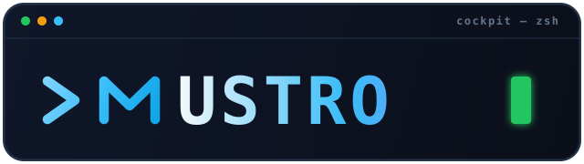

<p align="center">
  
</p>

# MUSTRO

**One command, your whole stack.**  
A fast, mouse-interactive Terminal User Interface (TUI) for orchestrating local multi-service development stacks.

---

## Features

- **DAG Dependency Boot** — Starts services in topological order and probes TCP ports before launching dependents.
- **Multi-Command Pipelines** — Run `preStart` tasks sequentially (migrations, codegen, builds) before starting the main process.
- **Mouse & Drag Support** — Click service cards and tabs, scroll with the mouse wheel, and drag-select log text.
- **JSON Log Inspector & Copy** — Expand structured JSON logs inline (<kbd>v</kbd> / <kbd>i</kbd>) and copy to clipboard (<kbd>c</kbd>) via native OS tools or OSC 52.
- **Zoom & Wrap** — Maximize any log pane fullscreen (<kbd>z</kbd>) or toggle line wrapping (<kbd>w</kbd>).
- **Zero Zombie Processes** — Terminates full process trees cleanly on exit or restart.
- **Auto-Detection & Setup Wizard** — Scans your workspace for Node.js, Python, Rust, and Go services to generate a config interactively.
- **Multi-Profile Switching** — Switch between `*.mustro.json` profiles on the fly (<kbd>p</kbd>).

---

## Quick Start

**Requirements:** Node.js `>= 18.0.0`

```bash
# Run directly without installing
npx mustro

# Or install globally
npm install -g mustro
mustro
```

If no config file is found in your project, MUSTRO opens an interactive Setup Wizard to auto-detect services and generate one.

---

## CLI Usage

```bash
mustro                        # Auto-detect config or launch Setup Wizard
mustro -c ./staging.json      # Load a specific config file
mustro local.mustro.json      # Load config as positional argument
mustro -v, --version          # Show version
mustro -h, --help             # Show help
```

---

## Configuration

MUSTRO auto-discovers `mustro.json`, `config.mustro.json`, `mustro.config.json`, or `*.mustro.json`.

```json
{
  "name": "Acme Stack",
  "settings": {
    "bootStaggerMs": 400,
    "maxConcurrentBoot": 3
  },
  "services": [
    {
      "name": "db-migrate",
      "path": "./services/db",
      "command": "npm run migrate"
    },
    {
      "name": "api",
      "path": "./services/api",
      "preStart": ["npm run build:types"],
      "command": "npm run dev",
      "port": 4001,
      "dependsOn": ["db-migrate"]
    },
    {
      "name": "web",
      "path": "./apps/web",
      "command": "npm run dev",
      "port": 3000,
      "dependsOn": ["api"]
    }
  ]
}
```

### Service Fields

| Field | Type | Required | Description |
| :--- | :--- | :--- | :--- |
| `name` | `string` | Yes | Unique service name |
| `path` | `string` | Yes | Working directory |
| `command` | `string \| string[]` | Yes | Command(s) to run |
| `preStart` | `string[]` | No | Sequential setup commands before `command` |
| `port` | `number` | No | TCP port (`1–65535`) probed for readiness |
| `dependsOn` | `string[]` | No | Services that must be ready first |
| `autoStart` | `boolean` | No | Start automatically on launch (default: `true`) |

---

## Controls

| Key / Mouse | Action |
| :--- | :--- |
| <kbd>↑</kbd> <kbd>↓</kbd> / <kbd>j</kbd> <kbd>k</kbd> | Navigate services or scroll logs |
| <kbd>Enter</kbd> | Focus service logs |
| <kbd>Tab</kbd> / <kbd>t</kbd> | Switch panels |
| <kbd>1</kbd>–<kbd>4</kbd> or <kbd>←</kbd> <kbd>→</kbd> | Switch tabs (`Logs`, `Errors`, `Metrics`, `Env`) |
| <kbd>s</kbd> / <kbd>r</kbd> | Start/Stop or Restart selected service |
| <kbd>c</kbd> | Copy selected logs to clipboard |
| <kbd>z</kbd> / <kbd>w</kbd> | Toggle fullscreen Zoom / line Wrap |
| <kbd>v</kbd> / <kbd>i</kbd> / <kbd>Space</kbd> | Expand/collapse JSON log entry |
| <kbd>/</kbd> / <kbd>f</kbd> / <kbd>l</kbd> | Search logs / Filter by service / Pause live stream |
| <kbd>p</kbd> / <kbd>?</kbd> / <kbd>q</kbd> | Switch profile / Help / Quit |
| **Click / Drag / Scroll** | Select items, drag-select text, scroll panes |

---

## Development

```bash
git clone https://github.com/pawanbarbate/Mustro.git
cd Mustro
npm install
npm run dev     # Run locally
npm test        # Run test suite
npm run build   # Build dist/
```

---

## License

MIT — see [LICENSE](LICENSE).
