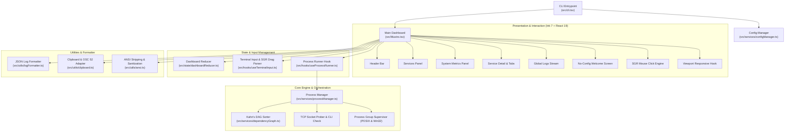

<p align="center">
  
</p>

# MUSTRO 🪄⚡

> **One command, your whole stack.**  
> *Local dev stack orchestration — fusing **Maestro** & **Muster**.*

Built with **React 19**, **Ink 7**, and **TypeScript**. **MUSTRO** transforms multi-service terminal chaos into an ultra-fast, mouse-interactive developer cockpit featuring DAG dependency boot cascades, multi-command pipelines, real-time log telemetry, JSON inspection, and adaptive terminal layouts.

---

## 🎭 The Story: Why MUSTRO?

The name **MUSTRO** is the funky lovechild of two essential engineering powers:

- 📯 **Muster** *(verb)*: To summon, assemble, and rally all your scattered services, workers, database migrations, and web apps into one unified formation.
- 🎻 **Maestro** *(noun)*: The master conductor standing at the podium, keeping perfect rhythm, cuing entries with a baton, and orchestrating complex harmonies without collisions.

👉 **MUSTRO** does both: it **musters** your unruly stack together and **conducts** them like a maestro with zero race conditions.

---

## ⚡ At a Glance

MUSTRO replaces clumsy tmux configs, cluttered terminal tabs, and heavy Electron dashboards with a lean, snappy Terminal User Interface (TUI).

```
 ┌────────────────────────────────────────────────────────────────────────────────────────┐
 │ 🪄 MUSTRO  │  Local Development Workspace                       v1.0.0 │ 🕒 10:24:17   │
 ├────────────────────────────┬───────────────────────────────────────────────────────────┤
 │ SERVICES (6)   [● 5 RUN]   │ AUTH SERVICE  ● RUNNING (:4000)  PID: 88421               │
 │ ┌────────────────────────┐ │ ┌─ [1: Logs] ── [2: Errors] ── [3: Metrics] ── [4: Env] ─┐ │
 │ │ ● auth           :4000 │ │ │ 10:24:12 [AUTH] DB migration step 1/2 complete         │ │
 │ │   npm run dev          │ │ │ 10:24:14 [AUTH] Listening on http://localhost:4000     │ │
 │ └────────────────────────┘ │ └─────────────────────────────────────────────────────────┘ │
 │ ┌────────────────────────┐ │ GLOBAL STREAM [All Services]                    ● LIVE    │
 │ │ ● gateway        :8080 │ │ 10:24:15 [GATEWAY] Proxy route /api/auth -> :4000        │
 │ │   npm run dev          │ │ 10:24:16 [PAYMENT] Stripe webhook worker listening        │
 │ └────────────────────────┘ │ 10:24:17 [USER]    Cache warmed (Redis :6379)             │
 ├────────────────────────────┼───────────────────────────────────────────────────────────┤
 │ SYSTEM (CPU: 24% | 1.8GB)  │ ? Help  ↑↓ Nav  Enter Logs  r Restart  s Stop  / Search   │
 └────────────────────────────┴───────────────────────────────────────────────────────────┘
```

---

## 🚀 Key Features

### 1. Directed Acyclic Graph (DAG) Dependency Boot
Never worry about race conditions between microservices again.
- **Kahn’s Topological Sorting:** Computes startup order in dependency waves (Tier 0 $\rightarrow$ Tier 1 $\rightarrow$ Tier $N$).
- **TCP Port Probing & CLI Inspection:** Verifies an upstream service's listening socket (`probeTcpPort` with IPv4/IPv6 dual-stack and `lsof`/`netstat` verification) before dependent downstream services are spawned.
- **Cycle & Orphan Detection:** Detects circular dependencies or missing services before launch, providing clear terminal diagnostics.
- **Boot Pacing & Staggering:** Prevents CPU/RAM spikes with configurable stagger intervals (`bootStaggerMs`) and concurrency limiting (`maxConcurrentBoot`).

### 2. Multi-Command Sequential Pipelines
Define multi-stage initialization per service:
- Run pre-flight steps sequentially (e.g. `npm run migrate`, `pnpm build`, `prisma db push`) before the persistent daemon starts.
- Clean status indicators for pipeline phases (`STEP 1/3`, `STEP 2/3`, `RUNNING`).

### 3. SGR 1006 / 1000 Mouse Engine & Drag Selection
A terminal interface that feels like a native desktop app:
- **Clickable UI Elements:** Click any service card to select, click navigation tabs (`Logs`, `Errors`, `Metrics`, `Env`), or click footer shortcuts.
- **Mouse Drag Text & Range Selection:** Drag horizontally across a log line to select characters, or drag vertically to select multi-line log ranges.
- **Smooth Mouse Wheel:** Scroll through service lists and streaming logs using terminal mouse wheel reporting (`<64;`, `<65;`).

### 4. Smart JSON Log Inspection & Clipboard Integration
- **Syntax-Highlighted JSON Viewer:** Expand complex structured JSON logs into formatted, colorized multi-line trees (<kbd>v</kbd>, <kbd>i</kbd>, <kbd>Enter</kbd>).
- **Universal Clipboard Copy:** Copy selected logs or text (<kbd>c</kbd>) using native OS clipboard tools (`pbcopy`, `xclip`, `powershell`) with automatic fallback to **OSC 52** for remote SSH and tmux sessions.
- **Zoom / Fullscreen Mode:** Maximize any log panel into fullscreen view (<kbd>z</kbd>) to analyze high-throughput logs without visual clutter.
- **Line Wrapping:** Toggle long log line wrapping on/off (<kbd>w</kbd>).

### 5. Zero-Leak Process Tree Supervision
- **POSIX Process Groups:** Sends signals to `-PID` to terminate the entire tree (parent + child subprocesses + background watchers) instantly.
- **Windows Process Tree Cleanliness:** Native `taskkill /pid /T /F` integration via safe binary execution (`execFileSync`).
- **Pre-Command Tracking:** Tracks pre-flight tasks to ensure migrations and builders are killed on shutdown with zero zombie processes left behind.
- **Graceful Shutdown:** Intercepts `SIGINT`/`SIGTERM` to stop all active services cleanly with an 800ms fallback hard-kill (`SIGKILL`).

### 6. Adaptive Responsive Layouts & Fast Startup
- **Auto-Sensing Viewport:** Dynamically monitors terminal width and height.
- **Dual-Column Mode ($\ge 72$ cols):** Side-by-side services navigator and deep log inspection pane.
- **Ultra-Narrow Mode ($< 72$ cols):** Automatic single-column layout with tabbed switcher (`[1: Services & Sys]`, `[2: Detail]`, `[3: Global Logs]`).
- **Compact & Ultra-Compact Heights ($< 18$ rows):** Condenses metrics and service cards to prevent viewport overflow and screen jitter.
- **Welcome & Loading Screens:** Displays a sleek onboarding card (`NoConfigWelcomeScreen`) when no configuration is detected and a high-speed loading meter during discovery.

### 7. Interactive Setup Wizard & Architecture Presets
- **Zero-Config Auto-Detection:** Automatically scans `apps/`, `services/`, `packages/`, `backend/`, and `frontend/` directories for **Node.js**, **Python**, **Rust (Cargo)**, and **Go** services.
- **Pre-Configured Architecture Templates:**
  - *Next.js + Express API*
  - *React (Vite) + FastAPI*
  - *Monorepo 3-Tier (Web + API + Worker)*
- **Visual In-Terminal Form:** Add, edit, remove, and configure ports, dependencies, and commands without leaving the terminal.

### 8. Multi-Profile Environment Selector
Switch between configurations on the fly:
- Store multiple configuration files (e.g., `dev.mustro.json`, `staging.mustro.json`, `e2e.mustro.json`).
- Press <kbd>p</kbd> to bring up the Profile Selector, preview service counts and ports, and switch environments instantly.

### 9. "Midnight Slate" Design System
- Engineered specifically for low eye strain and high readability in dark terminal environments.
- 24-bit TrueColor and OSC 11/111 canvas background management (`#0B0F19` canvas, `#0F172A` cards).
- WCAG AAA contrast hierarchy with Sky Blue, Emerald Green, Amber Gold, and Coral Red indicators.
- Distinct hashed badge colors for every microservice.

---

## 📦 Installation & Quickstart

### Prerequisites
- Node.js $\ge 18.0.0$
- Modern terminal with TrueColor and mouse reporting support (iTerm2, Alacritty, Ghostty, Kitty, WezTerm, Windows Terminal, VS Code Terminal)

### Global CLI Installation
```bash
# Install globally via npm
npm install -g mustro

# Or run instantly with npx
npx mustro
```

### Local Project Setup
```bash
# Clone repository
git clone https://github.com/pawanbarbate/Mustro.git
cd Mustro

# Install dependencies
npm install

# Run development mode
npm run dev

# Run test suite
npm test

# Build production bundle
npm run build
```

---

## 🛠️ CLI Usage & Flags

MUSTRO automatically detects config files in your working directory. You can also inspect version, help, or specify profiles explicitly:

```bash
# Start MUSTRO (auto-detects config or launches Welcome / Setup Wizard)
mustro

# Show CLI usage and available options
mustro -h
mustro --help

# Display current MUSTRO version
mustro -v
mustro --version

# Specify an explicit configuration file
mustro -c ./mustro.json
mustro --config=./staging.mustro.json

# Pass configuration file as positional argument
mustro local.mustro.json
```

---

## ⚙️ Configuration Reference

MUSTRO uses a declarative JSON configuration (`mustro.json`, `config.mustro.json`, `mustro.config.json`, or `*.mustro.json`).

### Example: Fullstack Microservices Stack
```json
{
  "$schema": "https://mustro.dev/schema.json",
  "name": "Acme Commerce Stack",
  "version": "1.0.0",
  "settings": {
    "bootStaggerMs": 400,
    "maxConcurrentBoot": 3
  },
  "services": [
    {
      "name": "db-migration",
      "path": "./services/database",
      "command": "npm run migrate",
      "autoStart": true
    },
    {
      "name": "auth-service",
      "path": "./services/auth",
      "preStart": ["npm run build:types"],
      "command": "npm run dev",
      "port": 4001,
      "autoStart": true,
      "dependsOn": ["db-migration"]
    },
    {
      "name": "payment-service",
      "path": "./services/payment",
      "command": "npm run dev",
      "port": 4002,
      "autoStart": true,
      "dependsOn": ["auth-service"]
    },
    {
      "name": "web-frontend",
      "path": "./apps/web",
      "command": "npm run dev",
      "port": 3000,
      "autoStart": true,
      "dependsOn": ["auth-service", "payment-service"]
    }
  ]
}
```

### Configuration Options

#### Orchestrator Settings (`settings`)
| Property | Type | Default | Description |
| :--- | :--- | :--- | :--- |
| `bootStaggerMs` | `number` | `400` | Delay in milliseconds between starting services within the same dependency tier. |
| `maxConcurrentBoot` | `number` | `2` | Maximum number of services permitted to boot concurrently. |

#### Service Configuration (`services[]`)
| Property | Type | Required | Description |
| :--- | :--- | :--- | :--- |
| `name` | `string` | **Yes** | Unique service identifier (used for logging badges and dependencies). |
| `path` | `string` | **Yes** | Working directory of the service (relative to project root or absolute). |
| `command` | `string \| string[]` | **Yes** | Command or pipeline of commands to execute. |
| `preStart` | `string[]` | No | List of pre-flight commands executed sequentially before `command`. |
| `port` | `number` | No | Listening TCP port (1–65535). MUSTRO probes this port before declaring the service ready. |
| `dependsOn` | `string[]` | No | Names of upstream services that must be healthy before this service starts. |
| `autoStart` | `boolean` | No | Whether to boot automatically on launch (default: `true`). |

---

## ⌨️ Controls & Keybindings

| Key / Input | Action |
| :--- | :--- |
| <kbd>↑</kbd> / <kbd>↓</kbd> or <kbd>k</kbd> / <kbd>j</kbd> | Navigate services list or scroll active log pane |
| <kbd>Enter</kbd> | Switch focus into Service Details / Logs panel |
| <kbd>Tab</kbd> or <kbd>t</kbd> | Cycle focus between panels (or switch views in narrow mode) |
| <kbd>1</kbd> <kbd>2</kbd> <kbd>3</kbd> <kbd>4</kbd> | Switch detail tabs: **1: Logs**, **2: Errors**, **3: Metrics**, **4: Env** |
| <kbd>←</kbd> / <kbd>→</kbd> | Cycle through detail tabs horizontally |
| <kbd>r</kbd> | **Restart** currently selected service |
| <kbd>s</kbd> | **Start / Stop** toggle for currently selected service |
| <kbd>c</kbd> | **Copy** selected log or character range to system clipboard (OS + OSC 52) |
| <kbd>z</kbd> | **Zoom / Maximize** active log panel to full screen (toggle zoom/restore) |
| <kbd>w</kbd> | Toggle line **Wrap** mode on/off |
| <kbd>v</kbd> / <kbd>i</kbd> / <kbd>Space</kbd> | **Expand / Collapse** structured JSON log trees |
| <kbd>Ctrl+A</kbd> | Select all visible logs in active pane |
| <kbd>/</kbd> | Open global logs **Search** query bar |
| <kbd>f</kbd> | Cycle service **Filter** for logs stream |
| <kbd>l</kbd> | Pause / Resume **Live** log stream |
| <kbd>PgUp</kbd> / <kbd>PgDn</kbd> or <kbd>[</kbd> / <kbd>]</kbd> | Jump scroll history by 4 lines |
| <kbd>Home</kbd> / <kbd>End</kbd> | Jump to earliest / latest log entry |
| <kbd>p</kbd> | Open **Profile Selector** to switch config profiles |
| <kbd>?</kbd> | Toggle Help modal overlay |
| <kbd>q</kbd> or <kbd>Ctrl</kbd>+<kbd>c</kbd> | Clean shutdown and exit MUSTRO |
| **Mouse Left Click** | Select service card, focus panel, click tab, button, or log line |
| **Mouse Drag** | Select text characters or multi-line log ranges |
| **Mouse Wheel** | Scroll service list or streaming logs |

---

## 🏗️ Architecture & Internal Design

MUSTRO is structured into modular layers adhering to clean architectural separation:



---

## 📂 Project Structure

```text
Mustro/
├── LICENSE                        # MIT License
├── package.json                   # Package manifest & CLI bin definitions
├── tsconfig.json                  # Base TypeScript configuration
├── tsconfig.build.json            # Distribution build settings
├── src/
│   ├── cli.tsx                    # Binary bootstrap & terminal buffer setup
│   ├── Mustro.tsx                 # Root dashboard layout orchestrator
│   ├── index.ts                   # Library entrypoint exports
│   ├── components/                # UI components
│   │   ├── Header.tsx             # Universal header bar
│   │   ├── Footer.tsx             # Responsive keycap shortcuts & connection status
│   │   ├── ServicesPanel.tsx      # Service list with status & uptime cards
│   │   ├── SystemPanel.tsx        # CPU, RAM, and uptime health bars
│   │   ├── ServiceDetailPanel.tsx # Tabs: Logs, Errors, Metrics, Env
│   │   ├── GlobalLogsPanel.tsx    # Unified real-time log aggregator
│   │   ├── HelpModal.tsx          # Keybinding overlay
│   │   ├── ProgressBar.tsx        # ANSI progress meter
│   │   ├── common/
│   │   │   ├── ClickManager.tsx   # SGR mouse region registry & hit-tester
│   │   │   └── LoadingScreen.tsx  # Async startup loading spinner
│   │   ├── welcome/
│   │   │   └── NoConfigWelcomeScreen.tsx # Zero-config welcome onboarding card
│   │   ├── selector/
│   │   │   └── ConfigSelectorScreen.tsx # Multi-profile environment switcher
│   │   └── wizard/                # Interactive setup wizard
│   │       ├── SetupWizard.tsx    # Wizard flow container
│   │       ├── ServiceForm.tsx    # Service field editing component
│   │       ├── WizardFormPanel.tsx# Form layout container
│   │       ├── WizardRegistryPanel.tsx # Discovered services review
│   │       └── WizardFooter.tsx   # Wizard action buttons
│   ├── hooks/                     # Custom React hooks
│   │   ├── useProcessRunner.ts    # Process manager bridge hook
│   │   ├── useTerminalInput.ts    # Keyboard, mouse drag & SGR parsing hook
│   │   ├── useTerminalViewport.ts # Dynamic viewport measurement
│   │   └── useSpinner.ts          # Smooth ANSI spinner hook
│   ├── utils/                     # Output, ANSI & clipboard utilities
│   │   ├── ansi.ts                # ANSI stripping & control sequence sanitization
│   │   ├── clipboard.ts           # OS clipboard & OSC 52 terminal bridge
│   │   └── logFormatter.ts        # Structured JSON tokenizer & formatter
│   ├── services/                  # Business & orchestration logic
│   │   ├── processManager.ts      # Multi-process lifecycle & streaming
│   │   ├── dependencyGraph.ts     # Kahn's DAG topological resolver
│   │   └── configManager.ts       # Profile discovery, validation & auto-detection
│   ├── state/
│   │   └── dashboardReducer.ts    # Unified state management
│   ├── theme/
│   │   └── theme.ts               # "Midnight Slate" design tokens & ANSI codes
│   └── types/
│       ├── config.ts              # Schema & configuration types
│       └── index.ts               # Component and telemetry interfaces
└── test/                          # 28 automated test suites
    ├── dag_dependency_test.ts     # Kahn's algorithm unit tests
    ├── staggered_boot_test.ts     # Concurrency & pacing validation
    ├── mouse_click_test.tsx       # ClickManager hit-testing tests
    ├── clipboard_test.ts          # Clipboard & OSC 52 verification
    ├── footer_responsive_test.tsx # Footer width-budgeting tests
    ├── pre_release_hardening_test.ts # Port validation & sanitization
    └── ...
```

---

## 🧪 Testing

The repository features 28 automated verification suites covering unit logic, React Ink component rendering, mouse drag selection, and process lifecycles:

```bash
# Run the complete test suite
npm test
```

---

## 🤝 Contributing

Contributions are welcome! Please follow these steps:
1. Fork the repository (`https://github.com/pawanbarbate/Mustro`).
2. Create a feature branch (`git checkout -b feat/my-new-feature`).
3. Commit changes with conventional commits (`git commit -m 'feat: add docker-compose auto-detector'`).
4. Ensure all tests pass (`npm test`).
5. Open a Pull Request with a clear description and reproduction steps.

---

## 📄 License

MUSTRO is released under the **MIT License**. See [LICENSE](LICENSE) for details.

---
*Built with passion for developers who value speed, clarity, and terminal craftsmanship.*
